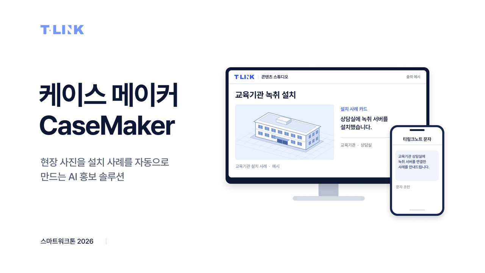

# 티링크 블로그 발행 스튜디오

교육기관 현장 사진과 메모로 네이버 블로그 원고를 쓰고, 검토한 글과 사진을 지정한 블로그의 SmartEditor ONE으로 전달하는 로컬 앱입니다. 같은 사례의 설치 카드와 문자 초안도 함께 준비합니다.

## 발표 자료

[](docs/smartworkathon-2026-presentation.pdf)

스마트워크톤 2026 발표 자료(PDF, 9쪽): [발표 자료 열기](docs/smartworkathon-2026-presentation.pdf)

## 시작하기

Node.js 22 이상이 필요합니다. 내장 네이버 MCP를 사용하려면 창을 열 수 있는 데스크톱 환경과 Google Chrome도 준비하세요.

```sh
npm ci
npm start
```

브라우저에서 [스튜디오](http://127.0.0.1:3000)를 엽니다. 서버 종료는 터미널에서 `Ctrl+C`입니다.

| 해 보고 싶은 작업 | 시작 위치 | 필요한 준비 |
| --- | --- | --- |
| 원고의 내용·서식·편집·내보내기 연습 | **준비된 예시로 연습** | 내장된 가상 사례 세 건과 CC0 자료 사진 |
| 개인 블로그에 실제 테스트 글 한 건 발행 | **연결 설정 → 내 블로그용 테스트 원고 열기** | 본인의 블로그 ID와 네이버 로그인 |
| 실제 설치 사례를 AI로 작성하고 발행 | **연결 설정** 후 현장 브리프 입력 | OpenAI 키, 승인한 제품 문구 및 상담 안내, 공개 가능한 현장 사진, 대상 블로그 로그인 |

새 학기 상담 접수, 방과후 문의 인계, 상담 일정 변경 예시는 각각 별도의 소제목·관찰 문장·체크리스트를 갖습니다. 예시 체험의 모델 호출은 0회이며 데모 검토 후 워터마크가 있는 PNG와 블로그 본문을 가져갈 수 있습니다. [사진 출처와 이용 조건](public/samples/SOURCES.md)

## 개인 계정에서 발행까지 시험하기

1. **연결 설정**에서 본인 네이버 블로그 주소의 ID를 입력하고 **설정 저장**을 누릅니다. 개인 계정 테스트에는 OpenAI 키와 실제 제품 자료가 필요 없습니다.
2. **네이버 로그인 열기**를 누릅니다. 전용 Chrome 창의 네이버 사이트에서 대상 계정으로 로그인하고 필요한 본인 확인을 완료합니다. **상태 다시 확인**에서 스튜디오와 발행 도구의 연결을 확인할 수 있습니다.
3. **내 블로그용 테스트 원고 열기**를 선택합니다. 제목이 `[연동 테스트]`로 시작하는 고정 원고와 공개 케이블 사진을 확인합니다. 이 작업은 실제 네이버 편집기에 담을 수 있는 원고를 준비합니다.
4. 문구·근거와 사진 확인을 각각 선택한 뒤 검토를 완료합니다. **네이버로 보내기**에서 대상 ID와 제목을 읽고 **이 원고 보내기**를 누릅니다.
5. 열려 있는 네이버 편집기에서 제목·본문·사진 및 공개 범위를 확인하고 **발행**을 마칩니다. 개인 점검용이라면 네이버 화면에서 원하는 공개 범위를 직접 고르세요.
6. 네이버에서 최종 발행한 뒤 게시물 화면을 열어 둔 채 스튜디오의 **발행 상태 확인**을 누릅니다. 자동으로 찾지 못하면 네이버에서 복사한 주소를 **발행한 게시물 주소**에 입력하고 다시 확인합니다. 대상 블로그와 글 제목이 일치하면 **게시물 열기**가 표시됩니다.

네이버는 기존 블로그 글쓰기 오픈 API를 2020년에 종료했습니다. 내장 MCP는 전용 로컬 브라우저에서 네이버의 편집기로 원고를 전달합니다. 최종 공개 범위와 발행 버튼은 네이버 창에서 사용자가 확인합니다. [네이버 공식 종료 공지](https://developers.naver.com/notice/article/7527)

## 실제 현장 원고 작성하기

1. **연결 설정**에서 OpenAI API 키와 모델을 설정합니다. 기본 모델은 `gpt-6.2-astra`입니다. 설정 저장 시 서버가 OpenAI에서 해당 모델의 접근 권한을 조회합니다. 모델이 프로젝트에 허용되어 있고 Chat Completions의 구조화 출력을 지원해야 합니다. [기본 모델 명세](https://developers.openai.com/api/docs/models/gpt-6.2-astra)
2. 실제 원문과 대조한 제품 문구·원문 위치·확인자·상담 안내를 입력하고 확인을 선택합니다. 선택 가능한 승인 근거가 한 건 이상 있어야 실시간 생성이 시작됩니다. 상담 문구는 승인 및 실제 내보내기·발행에 필요합니다.
3. 개인·기관 식별 정보를 미리 가린 JPEG 또는 PNG 사진, 설치 형태, 선택 입력인 지역·현장 메모를 준비합니다. 생성 단계는 모델에 텍스트와 허용된 근거만 보냅니다. 생성 요청당 모델 호출은 한 번이며 브라우저 대기 한도는 120초입니다.
4. 블로그 탭에서 **서식 미리보기**, **본문 편집**, **Markdown 원문**을 전환합니다. 제목과 소제목·서술 문단·인용문·목록을 수정하고 **수정 반영**을 누릅니다. 확인된 제품 근거와 상담 안내는 연결 설정에서 관리합니다. 원고를 수정하면 검토와 승인을 다시 진행합니다.
5. 두 검토 항목을 확인하고 승인한 뒤 선택한 채널의 결과를 가져가거나 **네이버로 보내기**를 진행합니다. 문자 발송용 본문은 확인된 광고 표기와 수신거부 안내가 모두 있을 때 복사할 수 있습니다. 스튜디오가 문자를 발송하는 기능은 없습니다.

블로그 문서에는 제목, 본문, 소제목, 인용구, 사진·캡션, 목록, 승인된 근거, 상담 안내, 태그가 들어갑니다. Markdown은 다른 편집기로 옮길 때 쓸 수 있습니다. SmartEditor ONE에는 본문 서식과 실제 사진 파일을 전달하며 최종 표시를 해당 편집기에서 확인합니다. [네이버 글 작성 및 서식 안내](https://help.naver.com/service/5593/contents/15515?lang=ko&osType=PC)

## 설정과 데이터 보관

- 연결 및 발행 API는 같은 기기의 루프백 주소에서 사용합니다. UI에 입력한 OpenAI 키·모델·블로그 ID·근거·상담 설정은 로컬 서버 프로세스 메모리에 머물며 서버를 재시작하면 환경변수와 파일의 기본값으로 돌아갑니다. 키 원문은 설정 조회 응답에 담지 않습니다.
- 서버 재시작 후에도 설정이 필요하면 로컬 환경변수 또는 Git에서 제외되는 `.env.local`의 `OPENAI_API_KEY`, `OPENAI_MODEL`, `NAVER_BLOG_ID`를 사용할 수 있습니다. 검증된 제품 근거는 [facts.json](server/facts.json), 상담·문자 설정은 [settings.json](server/settings.json)에 등록할 수 있습니다.
- 새로고침하면 화면에서 작성 중인 입력·원고·승인이 초기화됩니다. 서버는 발행 가능한 초안의 텍스트를 최대 두 시간 동안 메모리에 둡니다. 사진은 초안 생성 시 서버로 보내지 않으며 사용자가 대상 블로그로 전송을 확정했을 때 발행 경로에 포함됩니다.
- 전용 Chrome 로그인 프로필은 `.studio-runtime/naver-profile/`에, 중복 전송 방지용 내용 해시·처리 상태·게시 주소는 `.studio-runtime/publish/`에 저장합니다. 둘 다 Git에서 제외됩니다. Chrome 실행 파일 또는 전용 프로필 경로를 지정하려면 `NAVER_CHROME_PATH`, `NAVER_PROFILE_DIR`를 사용합니다.
- 전용 Chrome 창은 스튜디오와 별도 프로세스로 실행됩니다. 스튜디오를 다시 실행하면 같은 전용 창에 재연결하므로 로그인 중이거나 작성 중인 탭을 유지할 수 있습니다. 원하는 시점에 Chrome 창을 직접 닫으세요. 사용자 지정 프로필은 처음에 비어 있는 개인 디렉터리를 지정합니다.

## 외부 MCP 서버 연결

기본 연결은 함께 제공되는 로컬 stdio MCP입니다. 조직에서 운영하는 MCP 서버가 있으면 다음 값을 서버 환경에 설정하고 재시작하세요.

| 환경변수 | 용도 |
| --- | --- |
| `NAVER_MCP_URL` | 신뢰하는 Streamable HTTP MCP 엔드포인트. 원격은 HTTPS, 루프백은 HTTP도 지원 |
| `NAVER_MCP_TOKEN` | 필요할 때 전송하는 서버 측 Bearer 토큰 |
| `NAVER_MCP_TOOL` | 호환 발행 도구 이름. 기본값 `publish_naver_blog` |

외부 MCP의 네이버 계정 로그인은 해당 서비스에서 완료합니다. 발행 도구는 `blogId`, 중복 방지 키 `idempotencyKey`, `title`, `tags`, `blocks`, `html`, `markdown`, `image`를 받습니다. 사진은 `{mimeType, data}`의 Base64 JPEG/PNG입니다. 외부 서버는 이 원고와 사진을 수신하므로 대상 조직이 관리하고 신뢰하는 주소를 지정하세요.

도구 결과 `draft`는 편집기로 전달된 상태입니다. `published` 판정에는 해당 블로그 ID와 글 번호가 포함된 유효한 네이버 게시물 URL이 필요합니다. `uncertain`이면 실제 블로그부터 열어 확인하세요. **발행 상태 확인**은 지원 시 `get_naver_publication`을 호출하고 원고를 재전송하지 않습니다.

## 검증 범위

`npm test`는 모의 모델 응답으로 근거 검증, 편집·렌더링, 승인·문자 제한, MCP 연결·오류·중복 전송과 게시 주소 판정을 검사합니다. 실제 계정 인수에는 지정된 계정으로 로그인한 뒤 네이버에서 최종 발행하고 게시물 링크에서 내용과 사진을 확인하는 과정이 필요합니다. SmartEditor의 UI 변경이나 계정별 화면 차이로 전송이 멈추면 열린 편집기를 확인하세요. 운영 모델로 입력부터 세 초안까지 5분 이내인지는 실제 키와 승인 자료로 측정합니다. [PRD](PRD.md) · [SRS](SRS.md) · [디자인 규격](DESIGN.md)

## 디자인 토큰 갱신

화면은 `DESIGN.md`에서 생성한 `public/design-tokens.css`의 색상·서체·간격·모서리 값을 사용합니다. 문서를 변경하면 저장소 루트에서 공식 CLI로 검사하고 CSS를 다시 생성하세요. 내보낸 CSS의 바깥 규칙만 브라우저 표준 `:root`로 바꾸므로 별도 CSS 빌드가 필요하지 않습니다.

```sh
npx --yes @google/design.md@0.4.0 lint DESIGN.md
design_tokens=$(npx --yes @google/design.md@0.4.0 export DESIGN.md --format css-tailwind) &&
  printf '%s\n' "$design_tokens" | sed '1s/^@theme /:root /' > public/design-tokens.css
```
